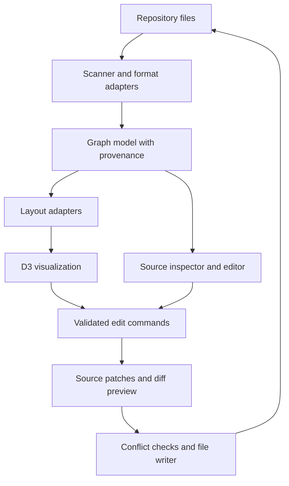

# Agent Architecture Explorer — Project Brief and Implementation Plan

Status: planning proposal, not a verified implementation specification.

## 1. Product goal

Build a local-first tool that scans a coding project and visualizes its agent instructions, skills, referenced documents, scripts, subagents, and MCP configuration. Users should be able to understand relationships, inspect source files, and eventually make supported edits directly from the visualization.

The primary visualization technology is **D3**, with a separate graph model and interchangeable layout engines. The tool should work alongside Cursor, Codex, Claude Code, or another coding client rather than depend on one specific client.

Core questions the product answers:

- What agent configuration exists in this repository?
- Where did each node and relationship come from?
- Which files reference a skill, document, script, or tool?
- What instructions apply to a particular directory or file?
- Can I edit a skill and review exactly which source bytes will change?
- Which relationships are explicit, inferred, unresolved, or merely proposed?

## 2. Critical semantic boundaries

An instruction graph is not automatically an executable workflow. A Markdown link establishes a reference; it does not prove that an agent loads or executes its target. Skill activation can depend on the client, prompt, runtime, and model decisions.

AGENTS.md usually provides scoped instructions. SKILL.md describes a packaged capability. MCP configuration describes available servers; it does not prove a particular skill invokes a server or tool. Client formats and precedence rules must be verified separately.

Do not invent a universal `tools:` field in SKILL.md or assume that changing an edge changes agent behavior. Each supported semantic operation must map to a real source construct understood by the relevant client. Unsupported relationships can be displayed or saved as application annotations, but must not be presented as operative agent configuration.

Represent four categories distinctly:

| Category | Meaning | Editing policy |
| --- | --- | --- |
| Explicit | Directly supported by source text/configuration | Editable only through a supported source operation |
| Derived | Computed from verified scope or structural rules | Change the underlying source, not the derived edge |
| Inferred | Heuristic or AI interpretation | Label confidence and explanation; no automatic source writes |
| Annotation | User-created organization or proposed flow | Store separately; does not change client execution |

If executable workflow authoring becomes a goal, introduce a separate workflow schema and an execution adapter. Do not silently reinterpret skill references as workflow steps.

## 3. Technology proposal

| Concern | Initial choice | Rationale |
| --- | --- | --- |
| Language | TypeScript | Shared types across scanner, model, API, and UI |
| Frontend | React + Vite | Lightweight local UI; React owns panels and forms |
| Graph rendering | D3 + SVG | Custom shapes, interaction, transitions, and visual encodings |
| Hierarchical layout | Dagre | Initial directed dependency view |
| Relationship layout | d3-force | Optional exploratory clustering |
| Nested layout | ELK.js, later | Compound groups, ports, and routed edges |
| Backend | Local Node.js process | Repository access, scanning, watching, and controlled writes |
| Source editor | Plain text editor initially; CodeMirror later | Keep the first edit loop small |
| Persistence | Source files + separate view metadata | Repository remains authoritative |

React Flow is optional and not required. It can consume positions computed by Dagre, but it should not be treated as having a mandatory built-in Dagre layout. D3 supports editing interactions, while this application must implement editing semantics, selection, commands, history, and validation.

Verify current APIs, package maintenance, licensing, and client configuration formats from official documentation before selecting versions. Earlier conversational examples were illustrative, not a dependency audit.

## 4. System architecture



D3 must not own the domain model. Layout engines calculate positions; rendering consumes positions. Semantic edits are domain commands that produce source patches. After applying a patch, reparse the affected source to obtain the authoritative graph.

Do not implement a generic graph-to-Markdown serializer that rewrites arbitrary files. Preserve untouched content, comments, unknown fields, formatting, line endings, and frontmatter wherever practical. Start with whole-file text editing plus version checks; add precise structured patches only for formats the application understands.

## 5. Proposed repository structure

```text
agent-architecture-explorer/
  apps/
    web/                 # React UI, D3 canvas, inspector, diff panel
    local-server/        # Local API, repository access, file watcher
  packages/
    core/                # Domain types, IDs, graph queries, commands
    scanner/             # File discovery and per-client adapters
    layout/              # Dagre, force, optional ELK adapters
    source-editing/      # Provenance, patch planning, validation, writes
    fixtures/            # Sample repositories and expected graphs
  docs/
    architecture.md
    supported-formats.md
    decisions.md
```

These are logical boundaries. The first implementation may use one app with modules rather than a fully configured monorepo. Avoid packaging overhead before the first working scan → inspect → edit loop.

## 6. Graph data model

```ts
type NodeKind =
  | 'instruction' | 'skill' | 'agent' | 'reference'
  | 'script' | 'mcp-server' | 'tool' | 'directory';

interface SourceLocation {
  path: string;                    // Repository-relative canonical path
  startOffset?: number;
  endOffset?: number;
  line?: number;                   // Display aid, not a durable identity
  contentHash: string;
  adapter: string;
}

interface AgentNode {
  id: string;                      // Stable across rescans when possible
  kind: NodeKind;
  name: string;
  source?: SourceLocation;
  attributes: Record<string, unknown>;
  diagnostics: string[];
}

interface AgentEdge {
  id: string;
  source: string;
  target: string;
  relation:
    | 'contains' | 'references' | 'configures'
    | 'applies-to' | 'invokes' | 'delegates-to' | 'annotation';
  evidence: 'explicit' | 'derived' | 'inferred' | 'annotation';
  provenance?: SourceLocation;
  explanation: string;
  confidence?: number;             // Only meaningful for inferred edges
  supportedOperations: string[];
}

interface AgentGraph {
  schemaVersion: number;
  nodes: AgentNode[];
  edges: AgentEdge[];
  diagnostics: GraphDiagnostic[];
}

interface GraphDiagnostic {
  code: string;
  message: string;
  path?: string;
  severity: 'info' | 'warning' | 'error';
}

interface GraphViewState {
  positions: Record<string, { x: number; y: number; pinned?: boolean }>;
  collapsedIds: string[];
  layout: 'hierarchy' | 'force' | 'compound';
}
```

Keep view state separate from semantic graph data. Store it in an application-owned location; make any repository metadata file opt-in. A client identity is separate from an actual configured subagent. Avoid adding pretend Codex/Claude/Cursor agent nodes that imply verified runtime behavior.

## 7. Scanner and parser behavior

Initial discovery targets:

- Root and nested AGENTS.md files.
- SKILL.md packages in configured repository skill roots.
- Local Markdown links and referenced scripts/assets within those packages.
- One explicitly chosen MCP configuration format, after checking its schema.

Later adapters can cover Cursor rules, Claude configuration/subagents, Codex-specific configuration, additional MCP formats, and explicitly enabled user-level configuration.

Requirements:

- Scan only the selected repository by default; user-level configuration requires an explicit scope choice.
- Avoid dependency folders, build output, binary files, and uncontrolled symlink traversal.
- Handle hidden configuration directories intentionally rather than excluding all dot directories.
- Normalize paths while retaining original source spelling for edits.
- Surface missing targets, malformed frontmatter, unsupported formats, and ambiguous references as diagnostics.
- Identify cycles without treating every reference cycle as an error.
- Parse deterministically first. AI interpretation is an optional layer with provenance.
- Redact credentials and secret-bearing MCP values from graph export and UI summaries.
- Do not execute discovered scripts, skill instructions, or MCP servers during scanning.
- Preserve multiple relationships between the same nodes and avoid duplicate discoveries.

Do not claim complete compatibility with a client until adapter fixtures cover its actual discovery and precedence rules.

## 8. Visualization and interaction design

### Architecture view

Directed layout showing instruction scopes, skills, references, and configured services. Use clear node shapes, readable labels, edge relation labels on selection, and a legend for evidence categories.

### Relationship view

Force layout showing shared dependencies and clusters. Allow pinned nodes, filtering by node type, neighborhood focus, and switching back to a stable hierarchy.

### Later analytical views

- Context size estimates by source file or selected scope.
- Shared references and heavily connected skills.
- Directory scope and instruction inheritance, where verified.
- Nested skill/package groups with ELK.
- Estimated prompt relevance, clearly labeled as heuristic.

Tree layouts are suitable only for tree projections. Shared dependencies and cycles need a general graph view or clearly marked duplicate visual instances.

Base interactions:

- Zoom, pan, fit graph, select, search, and highlight neighbors.
- Drag and pin nodes; movement updates view metadata only.
- Click a node to inspect path, raw source, diagnostics, and relationship evidence.
- Collapse a package without losing connections to external nodes.
- Keyboard-accessible list/inspector alternative to the graph.
- Reset layout and preserve useful positions during incremental rescans.

Use D3 for graph SVG and interaction, and React for surrounding UI. Avoid having both React and D3 mutate the same SVG elements. The first renderer should use one clear ownership approach, such as React owning the SVG container while D3 owns its graph subtree.

## 9. Editing model

| User action | Result |
| --- | --- |
| Move or pin node | Change visualization metadata |
| Change layout or collapse group | Change view state |
| Edit SKILL.md text | Plan a source file replacement |
| Add a local Markdown reference | Insert a supported link in a selected source location |
| Remove an explicit reference | Remove the corresponding source construct after preview |
| Draw an unsupported relationship | Create an annotation, or explain why it cannot be applied |
| Connect a skill to an MCP server | Annotation unless a verified adapter supports an actual source operation |
| Create a skill | Later: validate name/path and create a real supported package |

A drawn edge does not automatically create a semantic edit. The UI must show the relation type, evidence, target source, and exact operation before proposing a patch.

Edit pipeline:

1. Capture an edit command and its expected source hash.
2. Verify the adapter supports the operation.
3. Construct the smallest practical source change.
4. Validate the proposed file and graph impact.
5. Show a file-level diff and diagnostics.
6. Apply only after the user selects Apply.
7. Check source hashes again to detect concurrent editor changes.
8. Write with safe file replacement and reparse the affected files.
9. Refresh the graph while retaining selection and view state.

Provide undo for view operations. Semantic undo should be a reviewed inverse patch with current-version checks. For multi-file changes, either implement staging and rollback or restrict the first version to one file per apply; do not claim atomic multi-file writes without implementing them.

A local filesystem diff is sufficient for MVP; Git integration can add status and commit support later. A Git repository should not be required just to preview changes.

## 10. MVP delivery phases

### Phase 0 — Decisions and fixtures

- Inspect the target development repository and its existing conventions.
- Verify official D3, Dagre, skill format, and initial client documentation.
- Choose one primary client adapter and document its limits.
- Create fixtures with nested instructions, shared references, missing targets, cycles, unknown frontmatter fields, and concurrent edits.

Deliverable: architecture decisions, supported-format matrix, and implementation backlog.

### Phase 1 — Scanner and graph

- Discover AGENTS.md and configured SKILL.md roots.
- Parse source metadata and local links.
- Build stable nodes, edges, provenance, and diagnostics.
- Export a versioned graph JSON through a CLI.

Acceptance: fixture scans produce expected relationships, and every explicit edge points to inspectable evidence. No source files are modified during scanning.

### Phase 2 — D3 viewer

- Build hierarchy view with Dagre.
- Implement zoom/pan, selection, search, filters, inspector, and draggable nodes.
- Add relation/evidence styling and persist view positions separately.

Acceptance: selecting a node reveals its source; dragging it does not alter repository configuration. The viewer handles disconnected nodes and reference cycles without crashing.

### Phase 3 — Skill source editing

- Edit the complete raw SKILL.md in the inspector.
- Show diff, validate format, detect external changes, apply, and rescan.
- Preserve unknown content and handle parse diagnostics without data loss.

Acceptance: only the intended file changes; external modifications block a stale overwrite; reparsing reflects the saved edit.

This phase completes the first useful editable MVP.

### Phase 4 — Supported relationship edits

- Add/remove explicit Markdown references through graph interactions.
- Explain unsupported edges and offer annotations.
- Add command history and appropriate inverse patches.

Acceptance: every semantic graph edit has a source diff, a verified mapping, and current-version checks. No invented client configuration is written.

### Phase 5 — Additional views and adapters

- Add force view, package collapse, file watcher, and another client adapter.
- Add MCP summaries with secret redaction.
- Consider ELK when real nested-layout requirements justify it.

### Phase 6 — Analysis features

- Token estimates with a documented tokenizer or approximation.
- Candidate instruction overlaps/conflicts with evidence.
- Prompt relevance simulation labeled as an estimate.
- Optional imported runtime traces to distinguish observed loading from predicted loading.

Do not call static prompt simulation an exact replay of client context selection. Exact loading requires runtime evidence and client-specific instrumentation.

## 11. Validation strategy

Prioritize tests where correctness protects source files or graph meaning:

- Scanner fixtures for discovery, links, scopes, cycles, and malformed input.
- Preservation tests for source edits: comments, unknown fields, line endings, and untouched sections.
- Conflict tests for external changes between diff preview and apply.
- Path-boundary tests for traversal and symlink behavior.
- End-to-end edit → diff → apply → rescan check.
- A small representative graph benchmark; set a measurable responsiveness target after observing real repositories.

For layout, assert usable geometry and correct edge targets rather than brittle pixel-perfect coordinates. Keep semantic correctness independent of chosen visual layout.

## 12. Risks and open decisions

| Risk or decision | Proposed response |
| --- | --- |
| Natural-language references are ambiguous | Start with explicit links and typed evidence |
| Client discovery/precedence differs | Use isolated adapters and a capability matrix |
| Source rewriting loses information | Prefer raw editing and narrow patches |
| Moving a node looks like changing behavior | Separate view operations from semantic operations |
| D3 editor interaction work expands scope | Deliver source-panel editing before connection authoring |
| Force views become unreadable | Hierarchy default, filtering, neighborhood focus |
| Existing editor writes concurrently | Hash checks before applying and watcher refresh |
| Browser cannot freely access local repositories | Use a local backend; assess a desktop wrapper later |
| Configuration contains secrets | Redact exports and summaries; avoid logging credentials |
| AI infers nonexistent behavior | Mark inference and require evidence for source operations |

Planning questions to resolve in the project:

1. Which client and file formats should be supported first?
2. Local web app, desktop wrapper, or editor extension for the initial distribution?
3. Raw Markdown editor first, or structured frontmatter forms as well?
4. Where should view metadata and annotations live?
5. Are annotations sufficient for proposed flows, or is a separate executable workflow product needed?
6. What repository sizes and operating systems should the MVP support?

Recommended starting assumptions: local web app, TypeScript, React/Vite, D3/SVG, Dagre, raw SKILL.md editing, one primary client adapter, explicit references only, one source file per apply.

## 13. Handoff prompt for a coding AI client

Copy this file into the project as `docs/agent-architecture-explorer-plan.md`, then use:

> Read docs/agent-architecture-explorer-plan.md and inspect this repository before proposing changes. Treat this document as a product brief with provisional decisions, not as proof of current library APIs or client semantics. Verify relevant official documentation for the initial adapters and dependencies. Produce a concrete MVP implementation plan with milestones, module boundaries, dependencies, acceptance criteria, and a short list of unresolved decisions. Keep D3 as the visualization foundation, separate graph semantics from layout, and preserve source provenance. Start with deterministic scanning and a read-only viewer, then raw SKILL.md editing with diff preview and concurrent-change detection. Do not invent universal SKILL.md tool fields or treat references as executable flow. Prefer the smallest architecture that supports these boundaries. Ask only questions that materially block the first milestone. Do not implement all later analysis features in the MVP.

After approving that plan, request one vertical slice at a time: scan a fixture repository → render its graph → inspect source → edit one skill → review/apply the diff → reparse.

## 14. Official documentation starting points

These links are starting points for implementation verification, not sources independently checked while preparing this brief:

- D3: https://d3js.org/
- Dagre: https://github.com/dagrejs/dagre
- ELK.js: https://github.com/kieler/elkjs
- React Flow layout guidance: https://reactflow.dev/learn/layouting/layouting
- Agent Skills format: https://agentskills.io/
- AGENTS.md convention: https://agents.md/

